<div align="center">

<picture>
  <source media="(prefers-color-scheme: dark)" srcset=".github/assets/banner-dark.svg">
  
</picture>

**A professional camera pipeline with no JavaScript bridge in the frame path.**<br>
Capture photos and video, scan codes, and run bounded native frame processors while textures stay on the GPU.

[](https://packagist.org/packages/pushinbr/pam-native-camera)
[](https://github.com/push-in/pam-native-camera/releases/latest)

[](https://github.com/push-in/pam-native-camera/actions/workflows/ci.yml)
[](LICENSE)

[Install](#install) · [Quick example](#quick-example) · [Platforms](#platform-support) · [Permissions](#requirements) · [Docs](#docs) · [Issues](https://github.com/push-in/pam-native-camera/issues)

</div>

<a id="install"></a>
## <picture></picture> Install

Inside a PAM Native project, add only this capability:

```sh
pam composer require pushinbr/pam-native-camera
pam doctor --fix
```

New to PAM? Create a project with `pam init my-app --template native` (see the [PAM Native overview](https://push-in.github.io/pam-docs/native/overview/)), then come back here. Composer owns the manifest and the lockfile; `pam composer` runs it on PAM's verified PHP runtime.

<a id="quick-example"></a>
## <picture></picture> Quick example

```php
<?php

declare(strict_types=1);

use Pam\Native\Camera\CameraEventKind;
use Pam\Native\Camera\CameraFacing;
use Pam\Native\Camera\CameraMode;
use Pam\Native\Camera\CameraView;
use Pam\Native\Camera\CodeType;
use Pam\Native\Camera\FrameProcessor;

$preview = CameraView::make()
    ->facing(CameraFacing::Back)
    ->mode(CameraMode::PhotoAndVideo)
    ->fps(60)
    ->pinchToZoom()
    ->codeScanner([CodeType::Qr, CodeType::Ean13])
    ->frameProcessors([
        new FrameProcessor('acme.face-detector', ['confidence' => 0.8], maximumFps: 15),
    ])
    ->onEvent(function ($event): void {
        if ($event->kind === CameraEventKind::PhotoCaptured) {
            savePostPhoto($event->capture);
        }
    });
```

Frame processors are declared in PHP but execute in native code or Rust. Camera frames never cross into the PHP request loop: processor results are bounded events, and textures stay on the GPU.

<a id="platform-support"></a>
## <picture></picture> Platform support

| Platform | Support | Notes |
| --- | --- | --- |
| Android | API 26+ | CameraX 1.6.1, ML Kit barcode scanning |
| iOS | 15.0+ | AVFoundation, Vision, Metal |
| PAM Native | 0.8.0 to < 2.0.0 | From `pam-native.plugin.json`; PHP 8.5+ |

<a id="requirements"></a>
## <picture></picture> Permissions and requirements

| Platform | Declared by the plugin |
| --- | --- |
| Android | `android.permission.CAMERA`, `android.permission.RECORD_AUDIO` |
| iOS | `NSCameraUsageDescription` ("Capture photos and videos."), `NSMicrophoneUsageDescription` ("Record audio with videos.") |

Ask at runtime before you activate a preview:

```php
use Pam\Native\Camera\Camera;
use Pam\Native\Camera\CameraPermission;

(new Camera())->requestPermission(function (CameraPermission $permission): void {
    // CameraPermission::Authorized, Denied, Restricted or NotDetermined
}, microphone: true);
```

<a id="what-you-can-build"></a>
## <picture></picture> What you can build

- Social capture and creator tools
- Document, QR and barcode scanning
- On-device vision and custom native frame processors

There is no social, feed or streaming framework hidden in this package. Camera is an independent capability you can add to any PAM Native application.

| | |
| --- | --- |
| **Native path** | CameraX · AVFoundation |
| **Application model** | Composer package + generated native integration |
| **Design rule** | Independent module; no feed, vertical or application template bundled |

<a id="capabilities"></a>
## <picture></picture> Capabilities

- Camera discovery and format selection
- Photo and video capture
- Focus, exposure, zoom, torch, HDR and stabilization
- Front-camera mirroring and pinch-to-zoom
- QR and barcode scanning
- Bounded native frame-processor pipelines
- Lifecycle-safe sessions and interruption events
- Android CameraX and iOS AVFoundation implementations
- Integer-backed cross-platform contracts

<a id="production-rules"></a>
## <picture></picture> Production rules

- Request camera and microphone permissions through `Camera` before activating a preview.
- Select an advertised device and format; never assume that 4K, 60 FPS or HDR exists.
- Keep frame processing native and bounded by `maximumFps`.
- Pause the camera when it is outside the visible route.
- Test interruptions, backgrounding, thermal pressure and low-storage failures on physical devices.

<a id="docs"></a>
## <picture></picture> Docs

- [PAM Native overview](https://push-in.github.io/pam-docs/native/overview/)
- [PAM introduction](https://push-in.github.io/pam-docs/introduction/)
- [Changelog](CHANGELOG.md)
- [Report an issue](https://github.com/push-in/pam-native-camera/issues)

<a id="pam-ecosystem"></a>
## <picture></picture> Part of the PAM ecosystem

<p align="center"><picture>
  <source media="(prefers-color-scheme: dark)" srcset=".github/assets/pam-wordmark-dark.svg">
  
</picture></p>

PAM runs PHP natively on servers, desktops and phones. This repository is one piece of it.

| [**PAM**](https://github.com/push-in/pam) | [**PAM Desktop**](https://github.com/push-in/pam-desktop) | [**PAM Native**](https://github.com/push-in/pam-native) | [**Ecosystem**](https://github.com/push-in/pam#ecosystem) |
| --- | --- | --- | --- |
| the runtime and CLI | native desktop apps in PHP | native Android and iOS apps in PHP | every official package and plugin |

<sub>Docs: [push-in.github.io/pam-docs](https://push-in.github.io/pam-docs/introduction/) · [Issues](https://github.com/push-in/pam-native-camera/issues)</sub>

<p align="center"><sub><a href="LICENSE">Apache License 2.0</a> · Made in Brazil by Pushin</sub></p>
